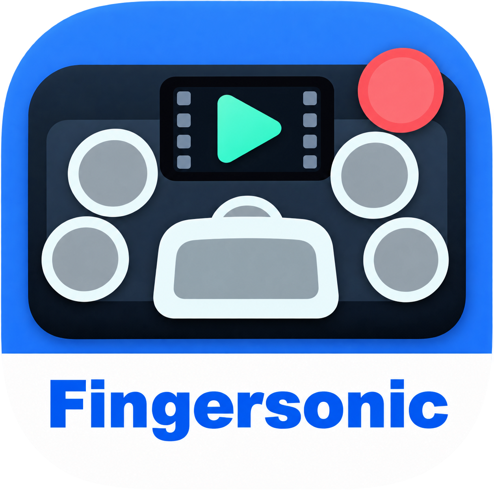

# Video Sampler for Fingersonic Beats

macOS AUv3 instrument · v0.4.6 (build 16)



Play local video clips with MIDI and send their audio directly into your DAW. Ten pads follow the Fingersonic Beats hardware layout, with independent video files, clip ranges, and MIDI notes. Logic Pro is the primary host.

## Install and play

Use the **AUv3 macOS ZIP** for a ready-to-use build. Xcode and source compilation are not required.

1. Quit Logic Pro, unzip the download, and drag the complete `Video Sampler.app` into **Applications**.
2. Open the app once. If macOS blocks it, follow **System Settings → Privacy & Security → Open Anyway** after confirming the download is trustworthy.
3. In Logic Pro, create a **Software Instrument** track.
4. In its Instrument slot, choose **AU Instruments → Fingersonic → Video Sampler → Stereo**.
5. Assign a video to a pad, set its Start and End positions, and trigger it with MIDI or **Preview**.

**This is an AUv3 plug-in.** The `.app` contains the Audio Unit extension and is its installation container. Keep the complete app in Applications; use the sampler inside your DAW. Do not extract its `.appex` or copy it into the AUv2 Components folder. The container app provides setup guidance rather than a standalone sampling workflow.

See the [Installation and User Guide](docs/INSTALL.md) for first-launch approval, MIDI mapping, recording, project saving, removal, and troubleshooting. The release ZIPs also include offline HTML and plain-text guides.

## Requirements and distribution status

- macOS 13.0 or later; Universal Binary containing Apple Silicon arm64 and Intel x86_64.
- Logic Pro is the primary host. Other AUv3 instrument hosts have not been individually verified.
- Local video files with audio tracks that macOS can decode. MP4/MOV with H.264 video and AAC audio is a practical starting point.
- This test distribution uses **ad-hoc code signing**. It has no Developer ID distribution signature and has not been notarized by Apple. First-launch approval may be required.
- Both architectures are included; this does not mean every Mac, OS version, or host has been tested. See the included verification report for actual coverage.
- This project does not include AUv2 `.component`, VST, VST3, AAX, Windows, or iOS builds.

## Features

- Ten independent video pads and up to 16 simultaneous audio voices.
- Per-pad Start/End trimming with video-frame preview while dragging. A new video initially uses its first two seconds, or its full duration if shorter.
- MIDI Note On triggering, velocity-sensitive volume, MIDI Learn, and manual note assignment.
- Live multiview video playback. Retriggering a pad restarts its video.
- Predecoded PCM audio returned through the host's instrument track for MIDI recording, bouncing, or Bus recording.
- Pad configuration, trim ranges, file-access bookmarks, MIDI notes, and output gain saved with the host project.
- Automatable Output Gain. Offline bounce renders audio only.

Version 0.4.6 adds a Fingersonic family app icon and fixes **Open Logic Pro**. The button discovers Logic Pro and Logic Pro Creator Studio by application identifier and displays launch errors.

## Build from source

Open `VideoSampler.xcodeproj` and select the **Video Sampler** scheme, or run this from the project root:

```bash
zsh scripts/build_release.sh
```

The app is written to `.build/ReleaseDerivedData/Build/Products/Release/Video Sampler.app`. The script explicitly builds arm64 and x86_64, signs the app ad hoc, and checks its signature and architectures. It does not install the result.

To install a local build at `/Applications/Video Sampler.app`, quit your host first, then run:

```bash
zsh scripts/build_and_install.sh
```

This updates the app at that location and registers its AUv3 extension. Development requires full Xcode and the macOS SDK. This release was built with Xcode 26.6; older Xcode versions have not been verified.

## Verification

```bash
zsh scripts/test_dsp.sh
zsh scripts/test_video_decode.sh
zsh scripts/test_offline_bounce.sh
```

The last two tests require `ffmpeg`; end users do not need it. Audio/video tests need access to AVFoundation and system file-bookmark services, which a restricted execution sandbox may block.

After installation, validate the system-registered Audio Unit with:

```bash
auval -v aumu vsmr FgSn
```

This validates the currently registered instance. See `VERIFICATION.txt` in the release for the actual results and limitations.

## Create release packages

From the project root, run:

```bash
python3 scripts/package_release.py
```

This builds the Universal app and writes an AUv3 ZIP, source ZIP, complete ZIP, offline guides, release-post text, and SHA-256 checksums under `dist/`. It does not upload files, replace the installed app, or grant trust automatically. Run regression tests separately before packaging; the packaging script only reports checks it actually performs.

GitHub publication uses `zsh scripts/publish_to_github.sh`. The target is `lastness09/Video-Sampler-for-Fingersonic-Beats`; a GitHub CLI login for `lastness09` is required. See [Publishing](docs/PUBLISHING.md) for the account checks and release workflow.

## Project layout

- `VideoSamplerHost/`: macOS container app and app icon.
- `VideoSamplerAU/Audio/`: Audio Unit, audio-track decoding, and project state.
- `VideoSamplerAU/DSP/`: C++20 playback engine and Objective-C++ bridge.
- `VideoSamplerAU/UI/`: SwiftUI editor, video preview, trimming, and MIDI Learn.
- `VideoSamplerAU/Shared/`: pad configuration and file-access bookmarks.
- `Tests/`: DSP, video-audio decoding, offline bounce, and project-state regression tests.
- `docs/`: user guide, release notes, and release-post text.
- `scripts/`: build, install, verification, and packaging scripts.

## Working with media

Video is shown while the plug-in editor is open; audio continues when the editor is closed. Original videos are referenced locally and are not copied into Logic projects. Keep them available and transfer them separately when moving a project. Re-select a video if its saved access is no longer valid.

Decoded clip audio stays in memory, so short clips are recommended. The plug-in does not export a combined video file; use a separate screen-recording workflow if you need a performance video.
